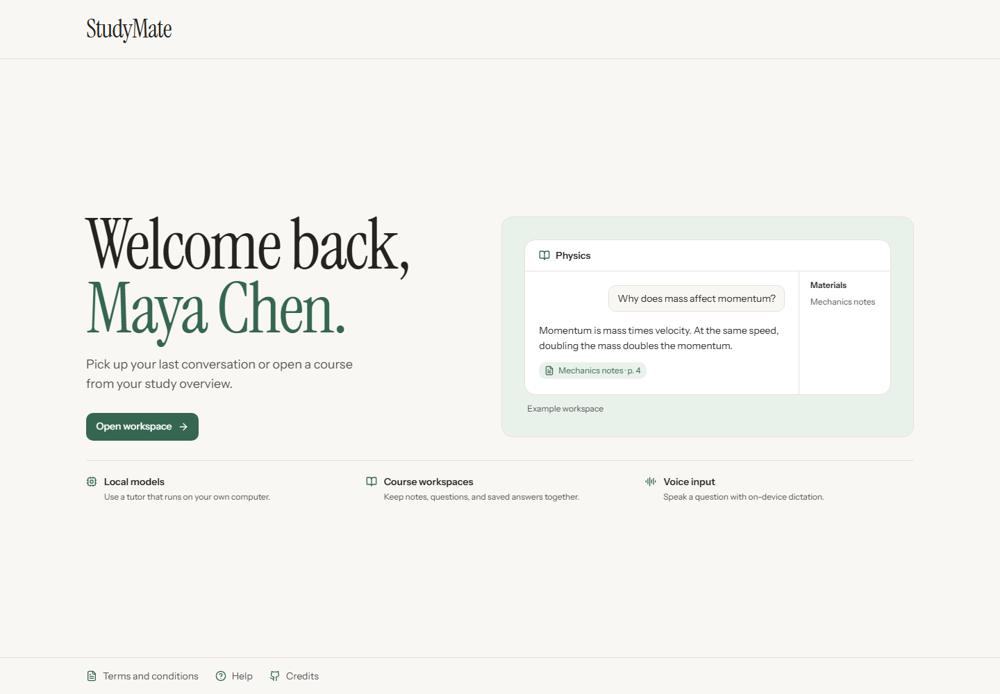
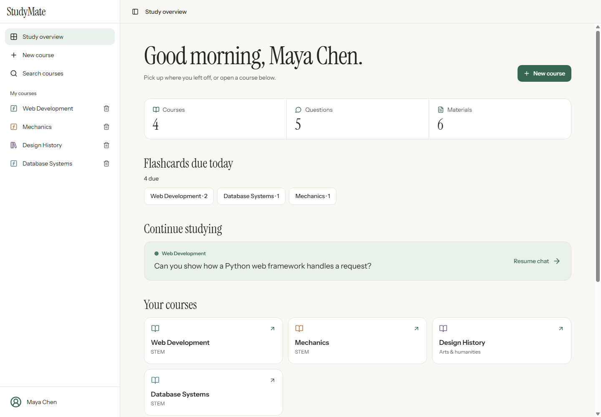
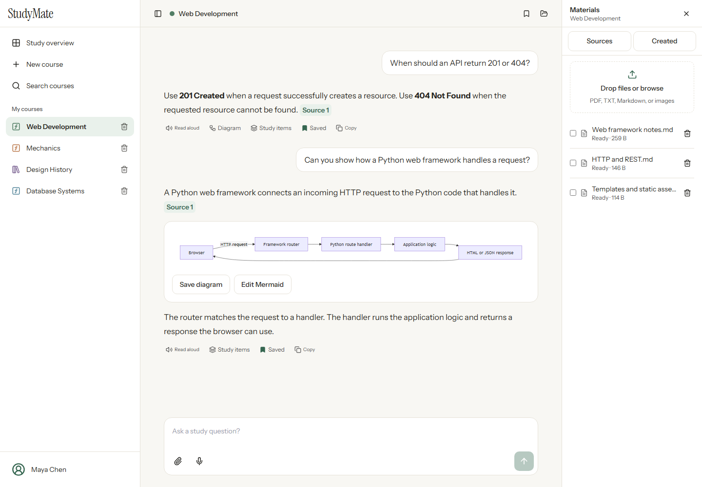
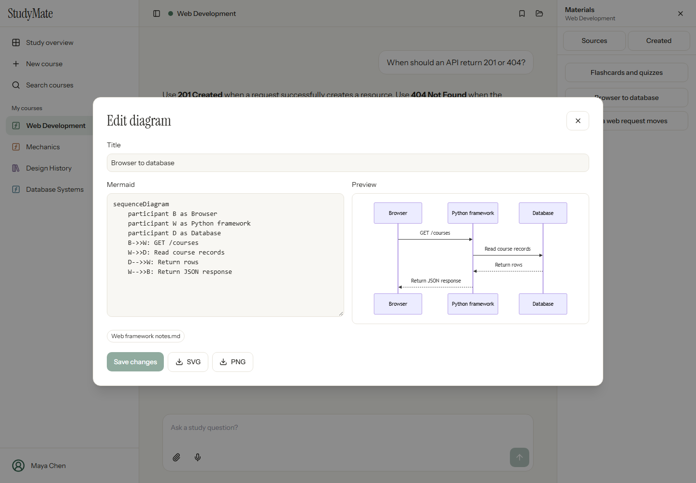
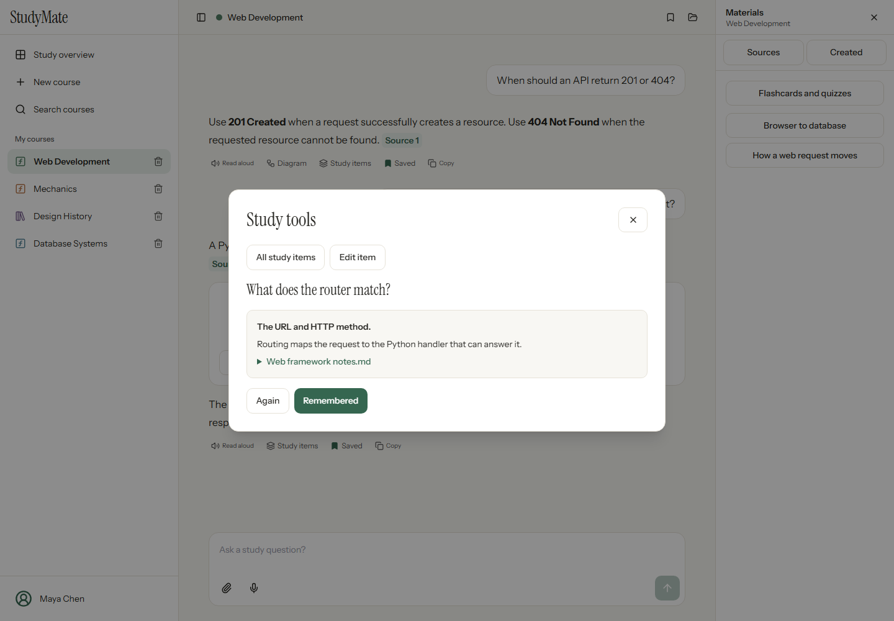
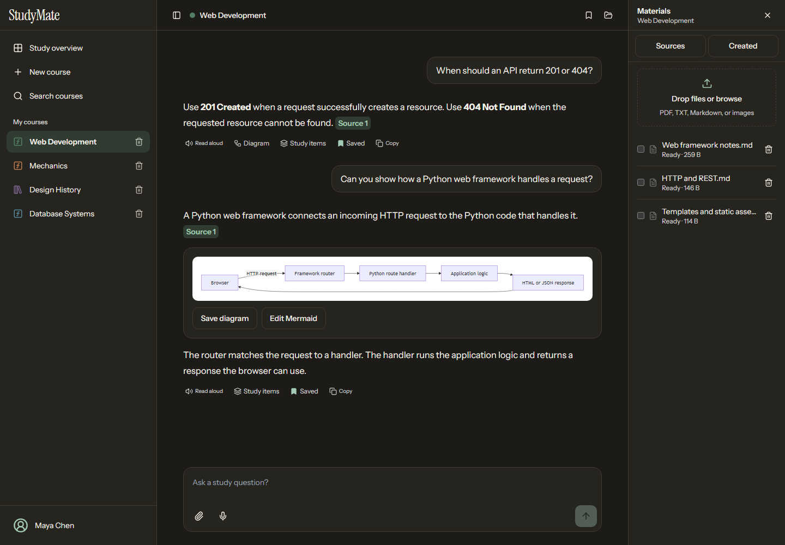
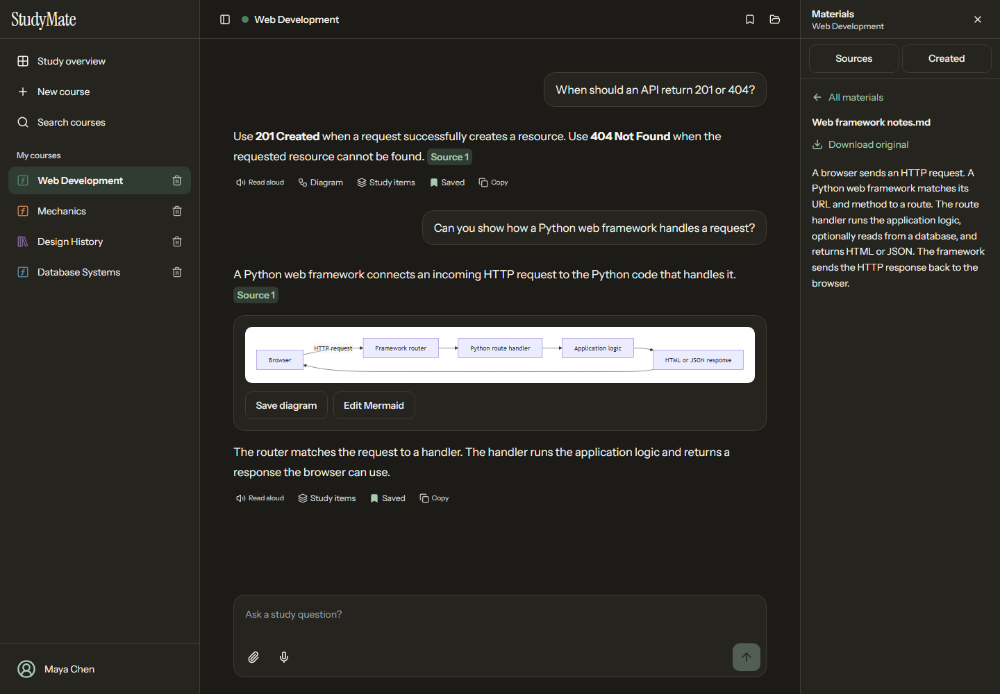
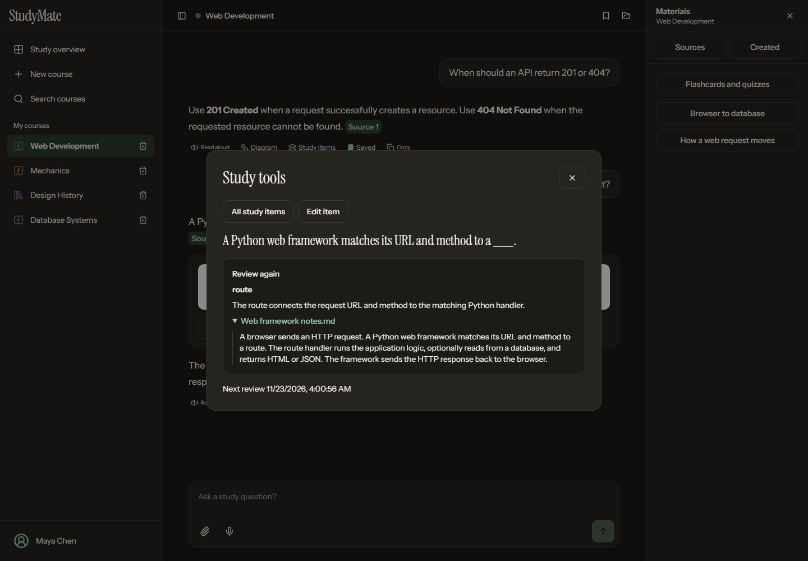
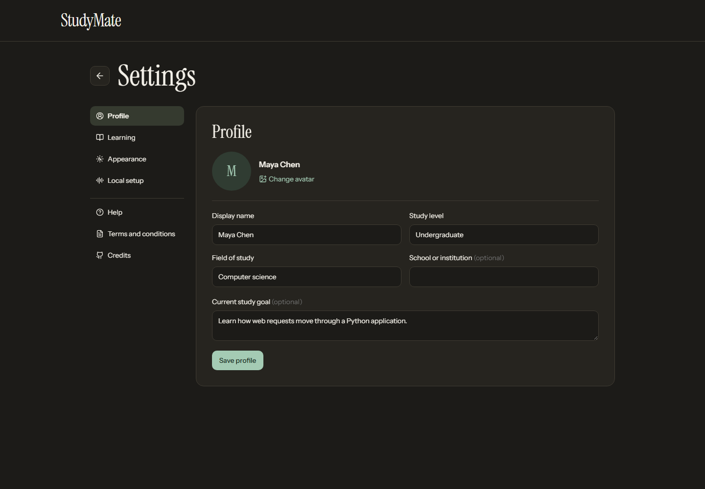

<p align="center">
  
</p>

<h1 align="center">StudyMate</h1>

<p align="center">An offline-first study workspace for Windows, macOS, and Linux.</p>

<p align="center">
  
  
  <a href="LICENSE"></a>
</p>

<p align="center">
  <a href="#features">Features</a> ?
  <a href="#screenshots">Screenshots</a> ?
  <a href="#student-how-to">Student how-to</a> ?
  <a href="#student-setup">Student setup</a> ?
  <a href="#contributing">Contributing</a>
</p>

StudyMate runs a local tutor on your computer and opens the workspace in your browser. Organize notes and chats by course, turn your materials into diagrams and flashcards, and study offline after downloading your models.

## Features

| Feature | What you can do |
| --- | --- |
| Course tutor | Start a course chat, ask follow-up questions, open cited source passages, and bookmark replies. |
| Study materials | Drop multiple PDFs, text files, Markdown, or images into Materials. Follow background processing and use sources once they show **Ready**. |
| Diagrams | Ask for a diagram in chat or create one from a reply or selected sources. Save flowcharts and sequence diagrams under **Created**, edit the Mermaid, and export SVG or PNG. |
| Study tools | Create editable flashcards and multiple-choice quizzes from source material. Open the supporting excerpt after a missed answer and review cards due today from Study overview. |
| Voice | Dictate using supported browser on-device recognition or Whisper. Read replies aloud using system voices or the optional offline Kokoro English voice. |
| Workspace | Switch between light and dark themes, manage learning preferences, and resume recent courses from Study overview. |

Text PDFs, TXT, and Markdown can be indexed locally. For scanned PDFs and images, install Tesseract and make it available on your PATH. Keyword search works with the built-in index. For optional semantic retrieval, pull an embedding model such as `all-minilm:22m`, set `EMBEDDING_MODEL=all-minilm:22m`, and restart StudyMate. New uploads use that model during indexing.

For offline dictation, **Settings → Local setup → Voice input** can download the Windows x64 Whisper runtime and Tiny English model. On other platforms, install `whisper-cli` first. To use Kokoro, open **Local setup → Read aloud** and select **Download Kokoro**.

## Screenshots



| Study overview | Course chat |
| --- | --- |
|  |  |

| Diagram editor | Flashcard review |
| --- | --- |
|  |  |

<details>
<summary>Dark-mode screenshots</summary>

| Course chat | Source preview |
| --- | --- |
|  |  |

| Quiz feedback | Profile settings |
| --- | --- |
|  |  |

</details>

## Student how-to

| I want to… | Steps |
| --- | --- |
| Draw a flowchart in chat | Open a course and ask “Draw a flowchart showing how a Python web framework handles a browser request.” The tutor can draw it directly in the reply. Choose **Save diagram** to keep it. |
| Diagram my notes | Open **Materials**, tick a **Ready** file, and choose **Diagram from source**. Pick **Flowchart** for steps and decisions or **Sequence diagram** for interactions, then **Generate diagram**. |
| Export a drawing | Open **Materials → Created**, select your saved diagram, then choose **SVG** or **PNG**. |
| Make flashcards or a quiz | Tick your **Ready** notes in **Materials → Create study items**, or choose **Study items** under a reply that cites your notes. Select **Flashcards** or **Multiple-choice quiz**, then **Generate**. |
| Practice later | Open **Materials → Created → Flashcards and quizzes**. For scheduled card review, open **Study overview → Flashcards due today**. |

The offline guide is available from your profile under **Settings → How to**.

## Student setup

1. Download the archive for your operating system and processor from [GitHub Releases](https://github.com/Shaswata28/StudyMate/releases) when it is available. Extract the entire folder.
2. Open `StudyMate.exe` on Windows or run `./StudyMate` from the extracted folder on macOS or Linux. Keep the launcher open while studying.
3. Create a local profile with your display name. Study level, field of study, and learning preferences are optional.
4. Open **Settings → Local setup**. Choose **Set up Ollama & model** or **Download & use**, depending on your setup status. Start with Compact on lower-memory devices.

Student archives bundle the frontend and backend. Ollama and the tutor model are set up separately. The release workflow targets Windows x64, macOS on Apple silicon and Intel, and Linux x64 and ARM64. Student executables are unsigned.

| Tutor tier | Model | Approximate download |
| --- | --- | ---: |
| Compact | Qwen3.5 0.8B | 1.0 GB |
| Balanced | Qwen3.5 2B | 1.9 GB |
| More capable | Qwen3.5 4B | 3.3–4.0 GB |

Automatic Ollama setup supports Windows and Linux on x64 and ARM64, and macOS on Apple silicon. On Intel Macs, use an existing Ollama installation. For branching flowcharts, StudyMate recommends Balanced if the device can run it.

## Local data

StudyMate stores its profile, preferences, courses, chats, and indexes in local SQLite. New original materials are kept in the matching course folder under `courses/<course-id>/materials/`. The app serves the student workspace on a loopback address.

| System | Default data directory |
| --- | --- |
| Windows | `%LOCALAPPDATA%\StudyMate` |
| macOS | `~/Library/Application Support/StudyMate` |
| Linux | `$XDG_DATA_HOME/studymate` or `~/.local/share/studymate` |

Use `STUDYMATE_DATA_DIR` to select a different directory. To upgrade, replace the extracted application folder and keep the app-data directory.

## Contributing

The workspace uses Next.js and TypeScript for the frontend, FastAPI for the backend, SQLite for storage, and Ollama for local inference. Release builds use Node.js 22 and Python 3.12.

Install the backend dependencies from the repository root with Python 3.12:

```sh
cd backend
python -m venv venv
# Activate venv before installing dependencies.
python -m pip install -r requirements.txt
```

Install frontend dependencies in a second terminal:

```sh
cd frontend
npm ci
```

On Windows, run `.\run_dev.bat` from the repository root to start both development servers. On macOS or Linux, run the following from the two terminals:

```sh
# From backend, with the virtual environment active
python -m uvicorn app.main:app --reload --host 127.0.0.1 --port 8000

# From frontend
npm run dev
```

Open `http://localhost:3000`. The API reference opens at `http://127.0.0.1:8000/docs`. The backend has working defaults. Use [backend/.env.example](backend/.env.example) as a reference if you need to override them.

To build the student workspace locally, set `STUDYMATE_RELEASE=1` and run `npm run build` in `frontend`. Then run `python backend/student_launcher.py` from the repository root with the backend environment active. Tagged workflow runs package the same launcher for the supported platforms and create a draft GitHub release. [Student release workflow](.github/workflows/student-release.yml)

StudyMate was created by [Shaswata28](https://github.com/Shaswata28). Report problems on [GitHub Issues](https://github.com/Shaswata28/StudyMate/issues).

## License

StudyMate is available under the [MIT License](LICENSE).
